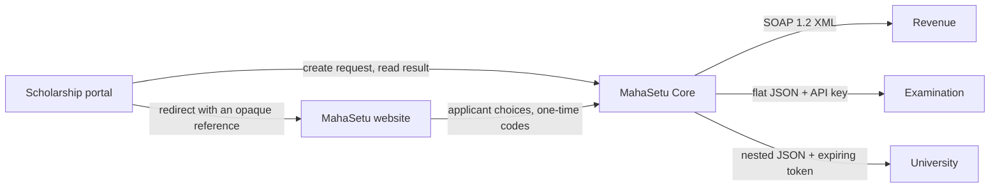
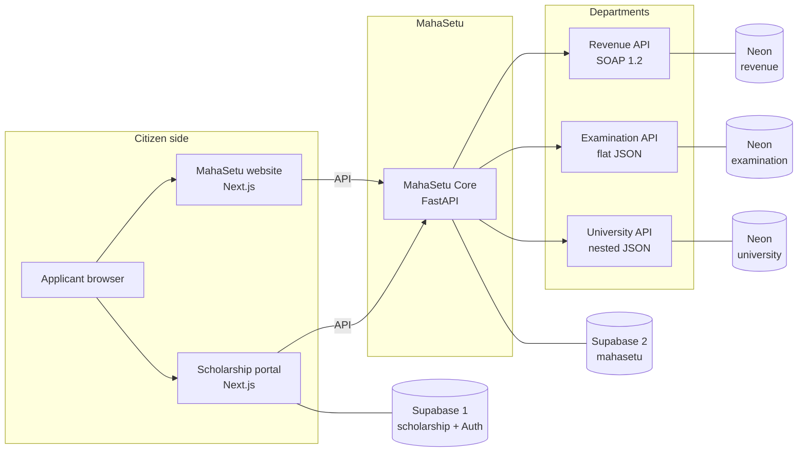

# MahaSetu

**One consented, standardized way for a government service to verify a citizen's documents held by other departments.**
MahaSetu replaces uploaded photocopies and one-off integrations with a single layer that asks each department for the real record, only after the citizen agrees, and returns a plain-language result.

> **Synthetic data only.** Every name, certificate, number and message in this project is made up. No real SMS is sent.

> [!IMPORTANT]
> **START HERE**
>
> | | |
> |---|---|
> | **Try the live demo** | **<https://mahasetu-portal-pk27.onrender.com>** |
> | **Judges' demo guide** (what to type, expected results) | **<https://mahasetu-portal-pk27.onrender.com/demo-guide>** |
> | **Simulated SMS inbox** (one-time codes and result messages) | **<https://mahasetu-site-pk27.onrender.com/messages>** |
> | **This repository holds** | MahaSetu Core: the orchestration, standardization and rules engine, the heart of the solution |
>
> Free hosting puts idle services to sleep. **The first request after a quiet period can take up to a minute**, and each hand-over between services can take several seconds. Please wait rather than reloading.

## Contents
[Problem](#the-problem) · [Solution](#the-proposed-solution) · [Why it works](#why-this-works) · [What the prototype demonstrates](#what-the-prototype-demonstrates) · [Try it](#try-it-in-two-minutes) · [Live links](#live-links) · [Architecture](#architecture) · [Tech stack](#tech-stack) · [What existing services must change](#what-existing-government-services-must-change) · [Repositories](#repositories-and-where-the-code-is) · [Verification](#how-it-was-verified) · [Limits](#honest-limits-of-the-prototype) · [Run it yourself](#run-it-yourself)

## The problem

A student applying for a scholarship must prove things that other departments already know: income and caste certificates (Revenue), SSC and Intermediate results (Examination), enrolment and a bonafide certificate (University). Today that proof usually arrives as uploaded copies that an officer checks by hand, or through a separate custom integration for every pair of services.

That causes four problems:

1. **Every integration is bespoke.** The three departments here speak three different languages: SOAP 1.2 XML with credentials, flat JSON with an API key, and nested JSON with an expiring token. With *N* services and *M* departments, nobody can afford *N × M* integrations.
2. **Citizens have no real say.** Documents are copied around instead of the citizen agreeing, department by department, to a specific lookup.
3. **Checks are slow and unreliable.** Officers re-verify by hand, and a copied document can be out of date or altered.
4. **Failures look like rejections.** When a department is slow or down, the applicant can end up marked as ineligible for a reason that was never theirs.

## The proposed solution

**MahaSetu is a neutral gateway between requesting services and departments.** The applicant starts in the portal they already use, is sent to MahaSetu, and agrees to each department separately with a one-time code. MahaSetu fetches only the records needed, converts three formats into one standard record, applies **approved** rules, and sends the applicant back with a result and the reasons in plain words. Records stay with the department that owns them.



## Why this works

- **One integration per side, not one per pair.** A new department needs one connector in Core. A new service needs one "Verify with MahaSetu" integration. Neither has to learn anyone else's format.
- **Consent is real and narrow.** A six-digit code, valid five minutes with three attempts, authorizes **one department** for **one request**. The applicant can decline or withdraw. Only the requested categories are kept.
- **Records are not copied around.** Raw department responses are never stored or logged. Core keeps standardized records for the request and an audit trail, and a withdrawn consent stops new calls.
- **Decisions are deterministic and explainable.** Only **approved, currently effective** rule versions run. Every check in a report carries a reason in plain language. AI is meant to *propose* rules and a human to *approve* them; the engine never executes an unapproved rule.
- **A technical failure is never the citizen's fault.** An unreachable department produces "Could not be completed" and is **never** counted as a failed check. The applicant can simply try again.
- **The portal cannot be tricked.** The return address only carries a reference. The portal always asks MahaSetu for the real outcome, scoped to that portal and that applicant.
- **Independent by design.** Every service owns its own database and talks to the others only through APIs. No service can read another's data.

## What the prototype demonstrates

| Capability | Where you can see it |
|---|---|
| A citizen applies for a scholarship and verifies with one click | Portal, **Verify with MahaSetu** |
| Three departments, three technologies, one standard record | MahaSetu Core and the three department websites |
| Separate consent per department with a one-time code | MahaSetu website, department cards |
| Rules produce **Verified / Not verified / Incomplete** with reasons | Result page, repeated in the portal |
| A simulated SMS explains any result that isn't "Verified" | SMS inbox |
| A department being down does not fail the student | Authorize one department, or stop one, and watch the result |
| **Five completely separate databases**, one per service, API-only between them | Architecture below, and the Render and database setup |
| The data each department really holds | The three department websites |

Five demonstration students cover every outcome:

| Student ID | Mobile | Result | Reasons shown |
|---|---|---|---|
| `MHSTU0001` | `9000000001` | **Verified** | all checks passed |
| `MHSTU0002` | `9000000002` | **Not verified** | annual income is above the limit for this scheme |
| `MHSTU0003` | `9000000003` | **Not verified** | income and caste certificates have expired |
| `MHSTU0004` | `9000000004` | **Incomplete** | no SSC result was found at the Examination Department |
| `MHSTU0005` | `9000000005` | **Incomplete** | enrolment is pending; no bonafide certificate was found |

## Try it in two minutes

1. Open the **[portal](https://mahasetu-portal-pk27.onrender.com/register)** and register with any name, an email ending in `@example.test`, and a password of 12+ characters.
2. Save the profile (any district), then **Create application**. Use income `125000`, a student ID and its mobile from the table above.
3. Choose **Verify with MahaSetu**. On the MahaSetu website, on each of the three department cards choose **Verify**, type the six-digit code shown, and choose **Confirm**.
4. Finish, read the result, and return to the portal. Check the **[SMS inbox](https://mahasetu-site-pk27.onrender.com/messages)**.
5. Open a **[department website](#live-links)**, enter the same student ID, and compare the record with the reason you were given.

The full step-by-step is on the portal's **[Demo guide](https://mahasetu-portal-pk27.onrender.com/demo-guide)**.

## Live links

> [!IMPORTANT]
> **All nine services are live.** Pages are for people; health addresses are for checking that a service is up.

### Pages

| Service | Link |
|---|---|
| **Scholarship portal** (start here) | <https://mahasetu-portal-pk27.onrender.com> |
| Register | <https://mahasetu-portal-pk27.onrender.com/register> |
| **Demo guide for judges** | <https://mahasetu-portal-pk27.onrender.com/demo-guide> |
| **MahaSetu website** | <https://mahasetu-site-pk27.onrender.com> |
| **Simulated SMS inbox** | <https://mahasetu-site-pk27.onrender.com/messages> |
| **Revenue Department website** (income and caste certificates) | <https://mahasetu-revenue-web-pk27.onrender.com> |
| **Examination Department website** (SSC and Intermediate results) | <https://mahasetu-examination-web-pk27.onrender.com> |
| **University website** (registration and bonafide certificate) | <https://mahasetu-university-web-pk27.onrender.com> |

### API health

| Service | Health address | Expected reply |
|---|---|---|
| **MahaSetu Core** | <https://mahasetu-core-pk27.onrender.com/health> | `{"status":"ok"}` (also confirms Core's database) |
| Revenue API | <https://mahasetu-revenue-pk27.onrender.com/health> | `{"provider":"revenue","status":"ready","simulated":true}` |
| Examination API | <https://mahasetu-examination-pk27.onrender.com/health> | `{"provider":"examination","status":"ready","simulated":true}` |
| University API | <https://mahasetu-university-pk27.onrender.com/health> | `{"provider":"university","status":"ready","simulated":true}` |
| Scholarship portal | <https://mahasetu-portal-pk27.onrender.com/health> | `{"status":"ready"}` (reads its database) |
| MahaSetu website | <https://mahasetu-site-pk27.onrender.com/health> | `{"site":"mahasetu-dashboard","status":"ready"}` |
| Revenue website | <https://mahasetu-revenue-web-pk27.onrender.com/health> | `{"portal":"revenue","status":"ready"}` |
| Examination website | <https://mahasetu-examination-web-pk27.onrender.com/health> | `{"portal":"examination","status":"ready"}` |
| University website | <https://mahasetu-university-web-pk27.onrender.com/health> | `{"portal":"university","status":"ready"}` |

The department APIs and Core are APIs, so only `/health` answers in a browser; their other operations need credentials, as a real department's would.

## Architecture

Five databases, one per service. Services talk only through APIs.



The full request sequence, every Core operation and its errors are in **[docs/APPLICANT_FLOW.md](docs/APPLICANT_FLOW.md)**. The states a request can be in are in **[docs/TRANSACTION_STATES.md](docs/TRANSACTION_STATES.md)**. The machine-readable contract is **[contracts/v1/openapi.json](contracts/v1/openapi.json)**.

### Where the Core code is

| File | What it does |
|---|---|
| [`mahasetu_core/connectors.py`](mahasetu_core/connectors.py) | Calls the three departments, each in its own protocol and credentials |
| [`mahasetu_core/normalize.py`](mahasetu_core/normalize.py) | Converts three formats into one standard record |
| [`mahasetu_core/rules.py`](mahasetu_core/rules.py) | Executes only approved, applicable rule versions |
| [`mahasetu_core/service.py`](mahasetu_core/service.py) | Orchestration: consent, one-time codes, retrieval, results, messages |
| [`mahasetu_core/states.py`](mahasetu_core/states.py), [`vocab.py`](mahasetu_core/vocab.py), [`errors.py`](mahasetu_core/errors.py) | Result states, standard terms, and the rule that technical failures stay technical |
| [`mahasetu_core/api.py`](mahasetu_core/api.py), [`security.py`](mahasetu_core/security.py) | The HTTP API, credentials and hashing |
| [`db/`](db), [`contracts/`](contracts) | Core's own schema migrations and seed, and the API contract |
| [`tests/`](tests) | 104 tests, including in-process departments that speak the real protocols |

## Tech stack

| Layer | Technology |
|---|---|
| **Core and department APIs** | Python 3.12, FastAPI, Uvicorn, SQLAlchemy 2, Alembic, psycopg 3, httpx, lxml (SOAP and XML), jsonschema |
| **Web front ends** (portal, MahaSetu website, three department sites) | Next.js 16, React 19, TypeScript 5.9, Zod 4; Tailwind CSS 3 in the portal and department sites; `pg` in the portal; `fast-xml-parser` in the Revenue site |
| **Databases** | PostgreSQL with row-level security and one scoped login per service. **Supabase** (Postgres, Auth, Storage) for the scholarship portal and for Core; **Neon** serverless Postgres for each department |
| **Interfaces between services** | REST/JSON, SOAP 1.2 over HTTP, HTTP Basic, API key header, short-lived bearer tokens, OpenAPI 3 contract |
| **Packaging and hosting** | Docker (one image per service), Docker Compose for the laptop demo, **Render** free web services for the nine live services |
| **Testing** | pytest, Playwright (real-browser end-to-end tests), in-process fake departments, schema and contract validators |
| **Security building blocks** | Hashed launch references, session tokens and one-time codes; scoped bearer credentials; a per-department consent record; an audit log; return addresses validated against a registry |

## What existing government services must change

**Very little.** Nothing moves out of any department's system, and no department gains access to another's data. The prototype is built to show how small the required change is. Specifically:

### Departments (Revenue, Examination, University)

| Change | Size | Notes |
|---|---|---|
| **Keep your own database, format and system.** | none | MahaSetu adapts to your protocol, with one small connector on MahaSetu's side. The prototype speaks SOAP 1.2, flat JSON and nested JSON because those are what the three simulated departments already use. |
| **Offer one read-only lookup: "records for this student ID"**, in the protocol you already use. | one endpoint, if you don't already have one | It should return the record with its reference, status and issue and expiry dates. |
| **Issue MahaSetu one service credential** (a username and password, an API key, or a token client) with read-only access to that lookup. | one credential | The same way you would for any other trusted caller. |
| **Nothing else.** | none | No data migration, no new database, no shared storage, no change to citizens. |

### The requesting service (the scholarship portal)

| Change | Size | Notes |
|---|---|---|
| **Add one "Verify with MahaSetu" button.** | one server-side call | It creates a verification request with the student ID and mobile number. |
| **Add one return page.** | one page | It reads the outcome from MahaSetu by reference and shows it. It never trusts anything in the web address. |
| **Register once with MahaSetu**: a return address and a credential. | one registration | The portal keeps its own officer review and decisions. |

### The citizen

| Change | Size |
|---|---|
| Enter a one-time code for each department they agree to. | one extra step, which is the consent itself |

> [!NOTE]
> This is the prototype's design assumption, shown with simulated departments. Real departments would need to confirm their own lookup, their credential arrangements and their identifier scheme.

## Repositories and where the code is

> [!IMPORTANT]
> **This repository (`mahasetu`) is MahaSetu Core.** The rest of the system lives in six more public repositories, all linked below. To run everything on one machine, clone them side by side using the folder names shown.

| Repository | Folder name to use locally | What it is |
|---|---|---|
| **[mahasetu](https://github.com/PreethamCodes/mahasetu)** (this one) | `mahasetu-core` | **Core: consent, standardization, rules, orchestration, audit** |
| [mahasetu-deployment](https://github.com/PreethamCodes/mahasetu-deployment) | `mahasetu-deployment` | Docker Compose, local and hosted setup scripts, end-to-end tests |
| [scholorship-simulation-portal](https://github.com/PreethamCodes/scholorship-simulation-portal) | `scholarship-portal` | The requesting service: applications, sign-in, officer review, demo guide |
| [mahasetu-dashboard](https://github.com/PreethamCodes/mahasetu-dashboard) | `mahasetu-dashboard` | The applicant-facing MahaSetu website: department cards, one-time codes, result, SMS inbox |
| [revenue-service](https://github.com/PreethamCodes/revenue-service) | `revenue-service` | Revenue Department: SOAP 1.2 API and website |
| [examination-service](https://github.com/PreethamCodes/examination-service) | `examination-service` | Examination Department: API-key JSON API and website |
| [university-service](https://github.com/PreethamCodes/university-service) | `university-service` | University: bearer-token JSON API and website |

## How it was verified

| Check | Result |
|---|---|
| Core test suite | **104 tests** pass |
| Whole journey, five students, through a **real browser against the live hosted services** | **5 of 5 pass** (portal, MahaSetu, three departments, five databases, SMS inbox), about 85 seconds each on free hosting |
| Portal browser tests (13) and demo guide tests (4) | pass |
| Department websites, spot-checked for several students | each returns the record that matches MahaSetu's reason |
| Every service's health address | all nine answer |

Verified on 17 November 2026. The end-to-end test is `tests/test_demo.py` in the [deployment repository](https://github.com/PreethamCodes/mahasetu-deployment). It was written for a local stack, where it passes; against the hosted services it needs longer waits, because free hosting is slower than the test's default 5 seconds.

## Honest limits of the prototype

- **All data and services are synthetic and simulated.** The SMS is simulated, which is why one-time codes appear on screen. The demonstration rules are pre-approved synthetic rules.
- **AI rule drafting and human approval screens are designed but not built in this prototype.** The engine executes only approved rules, and the database stops the runtime identity from approving its own candidates.
- **The simulated SMS inbox has no login and shows one-time codes**, and mobile numbers are stored in plain text, which is acceptable only for synthetic data. A real deployment needs a real gateway and protections.
- **Operations and administration screens for MahaSetu staff are not built.**
- **Free hosting sleeps when idle**, so first requests are slow, and the department websites wait only about 8 seconds for their API.
- **The local Docker Compose run is provided but has not been exercised end to end on the author's machine.** The images are built and run by the hosting service, and the same code runs natively.

## Run it yourself

You don't need to: the [live demo](https://mahasetu-portal-pk27.onrender.com) is running. To run the whole system on one machine (needs Docker, Python 3.12+, Git):

```bash
mkdir mahasetu-system && cd mahasetu-system
git clone https://github.com/PreethamCodes/mahasetu mahasetu-core
git clone https://github.com/PreethamCodes/mahasetu-deployment
git clone https://github.com/PreethamCodes/scholorship-simulation-portal scholarship-portal
git clone https://github.com/PreethamCodes/mahasetu-dashboard
git clone https://github.com/PreethamCodes/revenue-service
git clone https://github.com/PreethamCodes/examination-service
git clone https://github.com/PreethamCodes/university-service

cd mahasetu-deployment
pip install -r tests/requirements.txt
python scripts/demo.py up        # builds and starts everything with synthetic credentials
python scripts/demo.py status    # every line should say "up"
```

Then open <http://localhost:3000> and follow the same steps as above. `python scripts/demo.py down` stops it.

To run only Core's tests, see **[docs/CORE_REFERENCE.md](docs/CORE_REFERENCE.md)**, which also documents Core's behaviour, decision order and configuration.

## More documentation

| Document | What's in it |
|---|---|
| **[docs/CORE_REFERENCE.md](docs/CORE_REFERENCE.md)** | Core's behaviour, decision order, configuration, tests and limits |
| **[docs/APPLICANT_FLOW.md](docs/APPLICANT_FLOW.md)** | The full sequence, every operation and its errors, the data model |
| **[docs/TRANSACTION_STATES.md](docs/TRANSACTION_STATES.md)** | Every state a verification can be in |
| **[contracts/v1/openapi.json](contracts/v1/openapi.json)** | The authoritative Core API contract |
