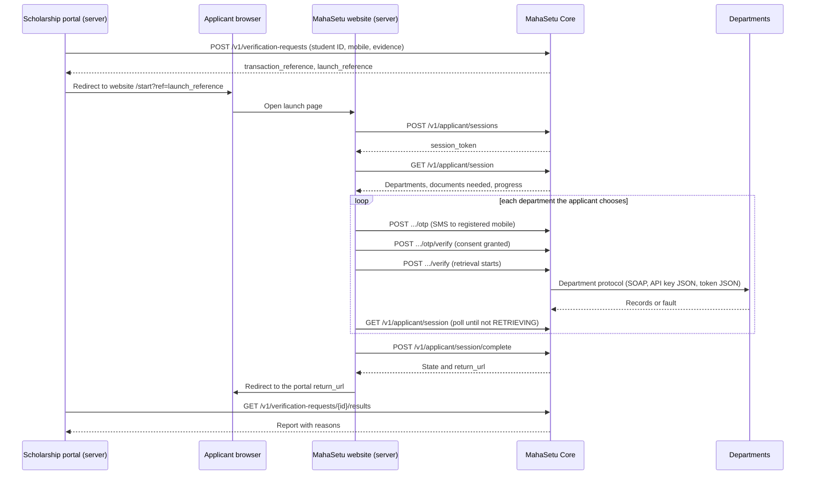

# Applicant flow and result messages

This guide explains the Core contract added in build stage 1 ([`contracts/v1/openapi.json`](../contracts/v1/openapi.json), version 1.1.0). The OpenAPI file is authoritative. Core implements every operation (build stage 2) and the MahaSetu website calls the website and applicant operations (stage 3); the Scholarship portal creates requests and reads results (stage 4).

## Parties and credentials

| Party | Credential | Used for |
|---|---|---|
| Requesting portal server (Scholarship) | `Requester` bearer, bound to one registered service | Create a request, read status and results, cancel |
| MahaSetu website server | `DashboardClient` bearer, never sent to a browser | Exchange a launch reference, list the demo SMS inbox |
| Applicant (through the website server) | `ApplicantSession` bearer, short-lived and bound to one transaction | Everything the applicant does |

## Sequence

Evidence, codes and mobile numbers never appear in a URL. The return address comes from the requester registry and carries only `ref=<transaction_reference>`. A launch reference is unguessable, expires (30 minutes by default) and may be exchanged again after a page reload.

## Operations

| Operation | Purpose | Notable errors |
|---|---|---|
| `POST /v1/verification-requests` | Create or replay (Idempotency-Key). Body adds `applicant_mobile`. | 409 changed payload |
| `POST /v1/applicant/sessions` | Launch reference to session | 410 LAUNCH_EXPIRED |
| `GET /v1/applicant/session` | Department cards: documents needed, status, `can_complete` | 401 expired session |
| `POST .../departments/{id}/otp` | Send a six-digit code (5 minutes, 3 attempts) | 429 resend too soon |
| `POST .../departments/{id}/otp/verify` | Check the code; grants consent for that department only | 400 INVALID_CODE, 410 OTP_EXPIRED, 429 OTP_ATTEMPTS_EXHAUSTED |
| `POST .../departments/{id}/verify` | Retrieve and standardize evidence (202, then poll) | 403 AUTHORIZATION_REQUIRED, 409 already running |
| `POST .../departments/{id}/decline` | Decline, or revoke a granted consent | 409 terminal |
| `POST /v1/applicant/session/complete` | Evaluate and finish; returns `return_url` | 409 RETRIEVAL_IN_PROGRESS |
| `GET /v1/applicant/session/result` | Applicant's report with reasons | 409 REPORT_PENDING |
| `GET /v1/messages` | Demo SMS inbox (website server only) | |
| `GET /health` | Liveness and database readiness | 503 |

## Outcomes and reasons

`VERIFIED` is success, `FAILED_CHECK` is failure, and `PARTIAL` means some checks passed while others failed or stayed unresolved. `INSUFFICIENT_DATA`, `RULES_NOT_CONFIGURED`, `MANUAL_REVIEW`, `ACCESS_DENIED`, `PROVIDER_ERROR` and `CANCELLED` are the other terminal states (see TRANSACTION_STATES.md). Every check in a report carries a machine `reason_code` and a plain-language `message`. A department outage appears as `NEEDS_REVIEW` with a `PROVIDER_` reason code and is never counted as a failed eligibility check; the department card shows `UNAVAILABLE` and can be retried.

| Demo student | Expected state | Reason the applicant sees |
|---|---|---|
| MHSTU0001 | VERIFIED | All checks passed |
| MHSTU0002 | FAILED_CHECK | Income above the demonstration ceiling |
| MHSTU0003 | FAILED_CHECK | Income and caste certificates have expired |
| MHSTU0004 | INSUFFICIENT_DATA | No examination record was found |
| MHSTU0005 | PARTIAL | Enrolment is pending and no bonafide certificate exists |

## Result messages (simulated SMS)

No carrier is involved. Core writes each message to its outbox and a sender interface marks it sent, so a real gateway can replace the simulator later. Two kinds exist: `OTP` and `VERIFICATION_RESULT`. When a transaction completes in any state other than `VERIFIED` or `CANCELLED`, Core queues exactly one result message to the registered mobile. It holds the transaction reference and the plain-language reasons only, never raw department data. Recipients are masked everywhere (`90•••••001`). `GET /v1/messages` lists messages by transaction or kind with cursor paging, which feeds the MahaSetu message inbox. A demonstration may set Core to include `demo_code` in the OTP response so the website can show a banner; production configurations never do.

## Data model in Core

Revision `mahasetu_0002` added the applicant-flow data to the foundation schema. All access is through the scoped runtime role with row-level security.

| Table | Purpose |
|---|---|
| `verification_requests` (extended) | The applicant's mobile number, a hash of the launch reference with its expiry, and the completion time. |
| `applicant_sessions` | Hash of each session token, its transaction and expiry. |
| `otp_challenges` | One row per code sent: keyed hash only, attempts, status, expiry and resend time. |
| `authorization_records` | One row per department that needs consent: PENDING, GRANTED, DENIED, REVOKED or EXPIRED. |
| `department_checks` | Retrieval progress per department (RETRIEVING, COMPLETED, UNAVAILABLE, STOPPED) with a run identifier so a late or superseded response is ignored. |
| `canonical_records` (extended) | One standardized record per category; superseded or redacted when consent is withdrawn. |
| `verification_results` (extended) | One row per check with department, plain-language message and order. |
| `message_outbox` | Simulated SMS. A unique index allows one result message per transaction. |
| `evidence_categories` | Document labels shown on the department cards. |
| `provider_call_logs`, `audit_events` | Technical call metadata and state changes; never raw department data. |

## Behaviour worth knowing

Replaying a create request with the same Idempotency-Key returns the same transaction with a fresh launch reference and retires the old one. A cancellation or a withdrawn consent stops new department calls; a response that arrives afterwards is audited as `LATE_RESPONSE_IGNORED` and never used. A retrieval left open for 90 seconds is released as UNAVAILABLE. Asking for a code again waits 30 seconds, an exhausted or expired challenge may be replaced at once, and at most five codes are issued per department. A department the applicant declined may be authorized again before completion. Authorization lasts 30 minutes, a session one hour and a launch reference 30 minutes by default.

## Compatibility note

Version 1.1.0 changes v1 in place: `applicant_mobile` is now required on request creation and each report check requires `message`. This is acceptable because no consumer of the v1 Core contract exists yet; after the first implementation ships, changes must be additive or move to v2.
